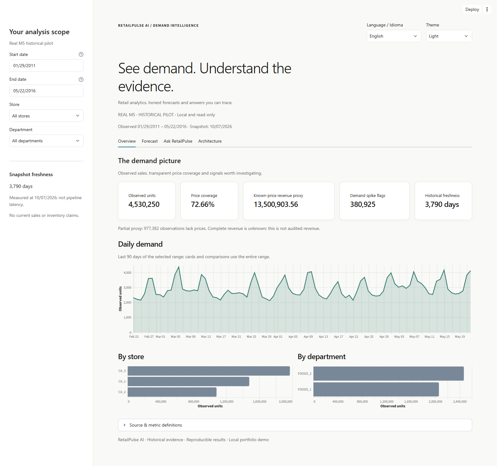
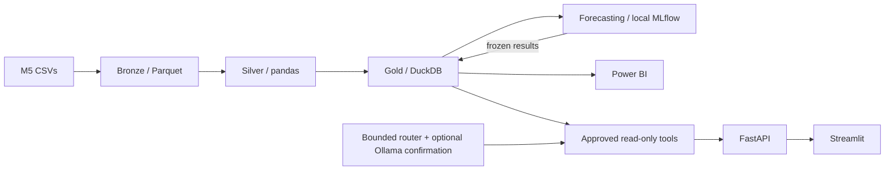

# RetailPulse AI

[](https://github.com/sjimenezch001/retailpulse-ai/actions/workflows/validate.yml)
[Resumo em português](README.pt-BR.md)

**Retail demand analytics with traceable figures and honest forecast comparisons.**
A personal portfolio project for commercial managers, BI analysts and planners who
need consistent answers about store demand, forecast error and data provenance.
It connects historical sales to one analytical source, then exposes it through
Power BI, a local web application and a bounded assistant.
The reports help users compare demand across stores and products, investigate
changes over time and assess where forecasts are less reliable. Reproducible
processing makes those comparisons traceable to the same data and metric definitions.

My focus in this portfolio is connecting business questions to reproducible SQL
metrics, report interpretation and explicit forecast trade-offs. Development used
agent-assisted editing and automated validation; recorded measurements and
release decisions are distinguished in the linked evidence.



Actual browser capture from the [validated bilingual UI](docs/evidence/rp10_ui_gate.md).
This is historical M5 data, not a live customer deployment.

## What it demonstrates

- Reproducible Bronze/Silver/Gold processing, quality gates and canonical SQL metrics.
- Fixed-origin forecasting, validation-only model selection and frozen backtests.
- Three Power BI pages and a FastAPI/Streamlit demo with English/Spanish and light/dark themes.
- Grounded answers with explicit period, filters, source, provider and limitations.
- A real AWS Glue 5.0 Spark and Athena demonstration, reconciled against synthetic data.

## Measured results

| Evidence | Result and boundary |
| --- | --- |
| [Historical M5 pilot](docs/evidence/rp09_real_acceptance.json) | **4,530,250 observed units**, across three stores and two departments; observations end 2016-05-22. |
| [Frozen test metrics](docs/model_card.md#final-one-time-test) | LightGBM **74.825958% WMAPE**, rolling mean **79.482353%**. MAE improves; RMSE worsens (**2.431177 vs 2.361194**). No measured revenue uplift. |
| [Actual local Ollama evaluation](docs/evidence/rp09_live_evaluation.json) | **36 expected outcomes passed**: **22 validated model calls**, **14 preflight outcomes**, **zero fallback**. A curated evaluation, not universal accuracy. |
| [Corrected RP-11 verification](docs/evidence/rp11/ci_corrections.json) | **254 passing tests**, **88.15%** combined line/branch coverage, **85%** enforced minimum. |
| [Published post-merge CI](https://github.com/sjimenezch001/retailpulse-ai/actions/runs/38274725819) | Four successful jobs: Windows, Ubuntu, container and aws-offline at `685839e7`, after PRs #16 and #17 merged. This run predates the v1.0.0 candidate. |
| [Real AWS reconciliation](docs/evidence/rp12d_live_validation.json) | Glue 5.0 Spark **SUCCEEDED** and **six real Athena SELECTs passed**: **252 synthetic facts, 1,386 units**. Real cloud execution; synthetic business figures, not M5 or production performance. |

The [claim-to-evidence index](docs/portfolio_evidence.md) links the measurements,
screenshots and caveats. [Current packaging acceptance](docs/evidence/rp13_gate.md)
separates completed checks from human and release work still pending.
Latest reported local validation: **440 passing tests**, **88.15%** coverage.
These local results are distinct from the published CI run and the earlier RP-11 result above.

## Actual architecture



The router establishes approved scope; optional local Ollama confirms the structured
selection. Tools retrieve figures and deterministic presentation renders the answer.
This is not unrestricted text-to-SQL or general-purpose conversation.
[Architecture and data grains](docs/architecture.md) distinguish pipeline writes
from read-only serving. The separate [AWS demonstration](docs/aws_live_demo.md)
uses managed Glue Spark, private S3, Glue Data Catalog and Athena. The local
application still uses pandas/DuckDB; PostgreSQL and MinIO are not deployed.

## Design decisions and trade-offs

- **Local-first reproduction:** explicit builds and a packaged synthetic demo let
  reviewers inspect the pipeline without cloud provisioning or restricted M5 inputs.
  Real data and model artifacts require a separate local build; this is not a hosted service.
- **DuckDB as the analytical source:** local SQL marts define shared metrics for
  reports and tools without a separate database server. This suits the portfolio's
  local analytical workload; it does not establish production-scale capacity.
- **Reconciled Power BI imports:** exported values are checked against Gold before
  report consumption. Separate fact grains and dimension filters preserve metric
  meaning; the reports use a refreshed snapshot rather than live transactions.
- **A separate, temporary AWS demonstration:** synthetic inputs exercise managed
  Glue Spark and Athena without moving historical M5 or frozen models into AWS.
  Execution and teardown evidence demonstrate the cloud path, not continuous hosting.
- **Controlled assistant tools:** parameterized templates and read-only access keep
  figures tied to canonical definitions. The narrower supported question patterns
  trade conversational flexibility for verifiable scope and explicit refusals.

See [architecture and boundaries](docs/architecture.md) and the
[validated BI model](dashboards/powerbi/dashboard_spec.md).

## What the Power BI pages help investigate

- **Executive Overview:** inspect demand trends and preceding-period comparisons,
  while using price coverage and historical freshness to interpret headline KPIs.
- **Store & Product Diagnostics:** compare stores, departments and products, then
  inspect weekly demand variations and spike flags to identify segments for investigation.
  These comparisons describe patterns; they do not establish causes.
- **Forecast Performance:** compare actual and predicted demand, examine error by
  horizon or segment, and assess the baseline comparison, including the RMSE trade-off.

The [report specification](dashboards/powerbi/dashboard_spec.md) explains filters
and metric boundaries; [Desktop acceptance and genuine screenshots](docs/evidence/rp08_gate.md)
document all three pages.

## Portable quick start

Prerequisites: Git, **Python 3.12**, and internet for installing pinned packages.
The first demo needs **no Kaggle data, Ollama, model training or Docker**.

Windows PowerShell:

```powershell
git clone https://github.com/sjimenezch001/retailpulse-ai.git
cd retailpulse-ai
py -3.12 -m venv .venv
.\.venv\Scripts\python.exe scripts/tasks.py setup
.\.venv\Scripts\python.exe -m retailpulse demo --mode synthetic --provider deterministic
```

Linux/macOS environment commands, after cloning:

```bash
python3.12 -m venv .venv
.venv/bin/python scripts/tasks.py setup
.venv/bin/python -m retailpulse demo --mode synthetic --provider deterministic
```

Open [Streamlit](http://127.0.0.1:8501) or [API docs](http://127.0.0.1:8000/docs).
Press **Ctrl+C** to stop both servers. Use `--api-port 8013 --ui-port 8513` if the
defaults are occupied. In Ask RetailPulse, ask: **How many units did SYN_A sell
during all observed dates?** Expected: **378 synthetic units**, explicitly offline.
The portable dataset and its simulated forecast comparison are not real model
performance evidence. [Mode details and troubleshooting](docs/web_demo.md).

These commands are checked in an [isolated automated reproduction](docs/evidence/rp13_gate.md#clean-environment-reproduction).
Independent verification by another person remains **PENDING**. PRs #16 and #17
published the portfolio documentation; the badge follows the currently published `main` revision.

## Real-data mode and entry points

With existing local Gold, run:

```powershell
.\.venv\Scripts\python.exe -m retailpulse demo --mode real --provider deterministic
```

For a fresh real-data build, follow [M5 acquisition and license boundaries](docs/data_source.md)
and the [ordered build commands](docs/web_demo.md#real-data-build-and-entry-points).
Real inputs, populated databases and frozen model binaries are not distributed.
Missing Gold is reported explicitly; it never silently becomes synthetic data.

| Entry point | Guide |
| --- | --- |
| Power BI Desktop | [Export and prepare the local PBIP](dashboards/powerbi/BUILD_GUIDE.md); data-filled PBIX stays local |
| FastAPI | [Requests and contracts](docs/api_examples.md); `/health`, `/ready`, `/metrics/summary`, `/forecast`, `/assistant/query` |
| Assistant CLI / optional Ollama | [Examples and verified live-model activation](docs/agent_demo.md); existing `qwen2.5:1.5b` only when installed |
| Product demo | [150-second walkthrough and captions](docs/web_demo.md#150-second-product-walkthrough) |

## Engineering quality

```powershell
.\.venv\Scripts\python.exe scripts/tasks.py verify
.\.venv\Scripts\python.exe scripts/tasks.py security
.\.venv\Scripts\python.exe scripts/tasks.py build
```

Verification includes Ruff, scoped strict mypy, synthetic regressions, coverage and
dependency compatibility. Security scans fail on unknown findings. Approved tools
use parameterized SQL, read-only DuckDB, disabled external access and bounded
resources. [Security and active main ruleset](docs/security.md),
[observability](docs/observability.md), [Docker workflow](docs/developer_workflow.md#portable-container).
Docker was validated in GitHub Actions; Docker Desktop is not required locally.

## Limitations and next steps

Historical sales are not current demand or inventory; zero sales do not prove
stockouts. `revenue_proxy` is not audited revenue, missing prices remain missing,
and spikes do not establish causes. Forecast gains on this pilot do not prove
business revenue impact. The local app has no public-service authentication;
the assistant is stateless with bounded English and Spanish patterns.

RP-00 through RP-11 are implemented. **RP-12D live AWS ETL and six-query
reconciliation passed**, and its teardown is documented; serving publication
was not performed.
The **v1.0.0 Portfolio Release** packages these implemented features. See the
[release notes](docs/release_notes_v1.0.0.md),
[release checklist](docs/release_checklist.md) and
[GitHub Releases](https://github.com/sjimenezch001/retailpulse-ai/releases)
for the current publication status.
I license the original project code under the [MIT license](LICENSE).
Third-party dependencies and external assets retain their own licenses;
M5 competition-data permissions are separate and real rows are not redistributed.

## AWS Live Demo — RP-12D

On 2026-10-11, I completed **S3 → Glue 5.0 Spark → Parquet → Glue Data
Catalog → Athena engine v3** in sa-east-1. Six allowlisted SELECTs reconciled 252 facts and
1,386 units: SYN_A 378, SYN_B 462 and SYN_C 546. Execution IDs, actual results,
scanned bytes, lineage and resolved packaging/response-validation incidents are
in the [live walkthrough](docs/aws_live_demo.md) and
[sanitized execution evidence](docs/evidence/rp12d_live_validation.json).

Deployment ownership is explicit: seven resources were Terraform-tracked, one
Glue job was created with Boto3, and two log groups were created in Console.
This is synthetic business data executed on real AWS services. It does not
establish commercial impact, a cloud model evaluation or a production deployment.
No serving metric, Lambda/API Gateway or Redshift workload was published.

The [final teardown report](docs/aws_teardown_report.md) records the removed job,
six Catalog resources, 27 S3 versions and my reported Console removals.
Terraform state is serial 31 with zero managed resources. Operator/bootstrap IAM
resources remain intentionally retained; the cause of final CloudWatch absence
is unverified. My reported October Billing observation is **USD 0.00
estimated payable with credits, invoice Pending**; gross consumption and settled
billing remain unverified. [Final handoff](RP-12D_FINAL_HANDOFF.md).
Earlier [RP-12A](docs/evidence/rp12_gate.md)
and [RP-12C](docs/evidence/rp12c_gate.md) gates record their historical offline scope.
The local demo still requires no AWS account, SDK, Terraform or Spark.

## Engineering lessons from the AWS demonstration

- **Glue dependency packaging:** the original dependency ZIP shadowed Glue's
  built-in Botocore resources, causing `DataNotFoundError`. Offline reproduction
  isolated the loader problem; a corrected package used Glue's built-in SDK and
  the subsequent job succeeded. Dependency contents must be tested against the
  managed runtime, not only checked for presence in an archive.
- **Athena response validation:** strict comparisons encountered omitted terminal
  semicolon/LF and default-catalog capitalization differences. Narrow normalization
  accepted only the observed representations; regression checks preceded the
  successful six-query run. Outgoing SQL and tool boundaries remained unchanged.

The [incident and teardown report](docs/aws_teardown_report.md#engineering-incidents-and-resolutions)
preserves the diagnosis and failure evidence. Both corrections illustrate bounded
changes followed by reproduction and validation in a temporary demonstration.
