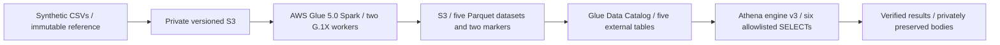

# RP-12D: real AWS demonstration and teardown

Final documentation review: **2026-10-12**. This was a temporary portfolio
laboratory in **sa-east-1**, using **synthetic business data on real AWS services**.
It is not a customer deployment, M5 cloud processing or production model evaluation.
The live ETL and query reconciliation succeeded; the workload, dedicated bucket
and Glue execution foundations were subsequently retired through separately
approved stages. Operator/bootstrap IAM resources were intentionally retained.

This report reconciles preserved local receipts and the owner's final observations.
No AWS API, Terraform operation or cleanup was performed for this documentation
review. Recorded API verification and owner-confirmed Console actions are labeled
separately; this is not a fresh account-wide absence or billing audit.

## Architecture and verified results

Glue produced `mart_sales_daily`, `dim_store`, `dim_product`,
`pipeline_metadata` and `store_units`, plus `_complete.json` and
`_metric_candidate.json`. Actual Parquet schemas, rows and values and both
markers matched the immutable synthetic reference. Six real Athena queries
independently reconciled the outputs.

| Validation | Recorded outcome |
| --- | --- |
| Fact grain | date × store_id × item_id; **252 rows**, 252 unique keys |
| Observed synthetic period | 2020-01-01 to 2020-02-11; 42 daily results |
| Total `units` | **1,386** |
| Store totals | SYN_A **378**; SYN_B **462**; SYN_C **546** |
| Dimension joins | Three stores, two products; 84 joined facts per store |
| Quality | Zero invalid units; seven missing prices; zero invalid null semantics |
| Glue | **SUCCEEDED**, five verified Parquet datasets and two markers |
| Athena | **6/6 SUCCEEDED and PASS**, complete results matched references |

Successful Glue JobRunId:
`jr_2705572727717d01f4a76ff67b5bc9b6540cde7aaaf79695e62ff315b7c62487`.
AWS reported **125 execution seconds and 250 DPUSeconds**; the launcher observed
142.297 seconds including polling. Athena reported 3,165 scanned bytes across the
six queries. These measurements are usage telemetry, not an invoice or a
production benchmark. All six QueryExecutionIds and complete observed results
are preserved in the [sanitized execution evidence](evidence/rp12d_live_validation.json)
and [live walkthrough](aws_live_demo.md#genuine-execution-identifiers-and-timings).

Missing prices remain explicit. Synthetic `units` and `revenue_proxy` do not
establish real revenue, commercial uplift or forecast accuracy. The local
M5/Gold application and frozen forecasting artifacts remain separate and unchanged.
Lambda, API Gateway, Bedrock, Redshift and serving metric publication were not
deployed or executed as part of this demonstration.

## Engineering incidents and resolutions

**Botocore dependency shadowing.** The first real Glue run failed with
`DataNotFoundError: Unable to load data for: endpoints`. The dependency ZIP
shadowed Glue's built-in boto3/botocore; Botocore's filesystem loader could not
load endpoint data through zipimport even though the JSON existed in the ZIP.
Offline reproduction confirmed the defect. A separately approved, versioned
6,250-byte replacement retained the five unchanged application members and used
Glue's built-in SDK. The next explicitly approved run succeeded. Original bundle,
failure receipt and seals remain preserved; live SDK module versions were not captured.

**Athena response normalization.** The first validator cancelled query
`2ac3b9c6-37d3-4f84-9f46-a953fd400b7d` while QUEUED after 0.281 seconds.
Athena omitted the outgoing SQL's terminal semicolon/LF and returned
`awsdatacatalog` instead of `AwsDataCatalog`. Both strict response comparisons
failed. The reviewed correction accepts only those observed representations,
keeps outgoing SQL byte-exact, and records individual field checks with short
diagnostic codes. Twenty-one offline regression tests preceded a new contract
and the successful six-query execution. No query, tool scope or security limit
was broadened; the cancelled receipt and original guard remain immutable.

**Cleanup and authentication stops.** A CloudWatch DeleteLogGroup request
returned AccessDeniedException, and a later private credential export timed out
before any cleanup SDK call. Both attempts stopped with their real partial or
zero-mutation outcomes recorded. A new owner-initiated attempt completed the
approved S3 version deletion after fresh authentication and inventory checks.
The silent export timeout's internal cause was not established.

## Ownership and teardown sequence

The deployment was deliberately documented as mixed ownership: the Athena
workgroup, Glue database and five tables were Terraform-tracked; the job was
created with Boto3; two custom log groups were Console-created. S3 and IAM
foundations were owner-managed outside workload state. It was not a fully
Terraform-managed deployment.

| Resource or stage | Final recorded result | Evidence classification |
| --- | --- | --- |
| Glue job `retailpulse-rp12-demo` | Deleted once; exact job verified absent | Preserved API deletion and readback receipt |
| Athena workgroup `retailpulse-rp12-demo` | Manually removed; missing resource reconciled by normal Terraform refresh | Owner action; subsequent recorded read-only not-found verification |
| Glue tables `dim_product`, `dim_store`, `mart_sales_daily`, `pipeline_metadata`, `store_units` and database `rp_rp12_demo` | Exactly six deletes, zero additions/modifications; all six verified absent | Exact reviewed Terraform saved plan, exit 0, per-resource API readback |
| S3 contents | **27 versions across 26 keys** permanently deleted by **one DeleteObjects request**, without automatic retries | All 27 Key/VersionId results matched; readback verified zero versions, markers and multipart uploads |
| S3 bucket | Deleted after the verified empty-bucket stage | Owner-confirmed AWS Console action; no local final deletion receipt or screenshot located |
| Glue execution role `retailpulse-rp12-demo-glue` | Deleted | Owner-confirmed Console action; no local final deletion receipt or screenshot located |
| Unused Glue boundary policy `retailpulse-rp12-demo-glue-boundary` | Deleted | Owner-confirmed Console action; no local final deletion receipt or screenshot located |
| CloudWatch `/retailpulse/rp12-demo/glue/error` and `/retailpulse/rp12-demo/glue/output` | Absent in the owner's final Console and CLI observations | Owner-confirmed absence; cause and deleting actor remain unverified |

The S3 receipt explicitly verified that the bucket **still existed immediately
after the 27-version deletion**. Its later Console deletion is a separate owner
confirmation, not a result attributed to that DeleteObjects request. No bucket
deletion or IAM mutation is attributed to the automated cleanup helpers.

The earlier CloudWatch receipt records a denied delete of the error group,
request `8d420185-4ca9-46eb-969d-9aa3c50841cc`; the output-group delete was not
attempted after that failure. The final owner observations supersede the old
presence observation but do not explain the disappearance. This report does
not claim that the denied request succeeded, that a retry occurred, or that
Terraform removed those untracked groups.

The operator role `RetailPulseLabOperator`, bootstrap role `RetailPulseBootstrap`
and five operator policies are **intentionally retained**:
`operator-storage`, `operator-identity`, `operator-workloads`,
`operator-guardrails-1` and `operator-guardrails-2` under the existing lab naming
prefix. Their retention is owner-confirmed, not an inventory performed in this
offline review. Historical operator trust continuity remains unverified.

## Terraform state and preserved evidence

The final operational state was independently read locally and matches the
successful cleanup receipt:

- **Serial: 31**; **zero managed resource instances**, including no remaining
  Glue Catalog resources or Athena workgroup.
- **SHA-256:** `3e93555c97253c55815a91f4b06d70632839e18b6e44a90392f02c11fe32d7de`.
- Terraform **1.15.9**, AWS provider **6.68.0**; the exact saved cleanup plan was
  applied once. Original serial-20 state, its earlier backup, plans and guards
  remain byte-preserved privately.

An empty managed workload state does not prove owner-managed IAM or Console
resources are absent. No state editing, import, state removal or new Terraform
operation was used for this report.

Three private archives passed their original SHA-256 and ZIP integrity checks:
the **699-member recovery archive**, the **25-member S3 evidence archive with
19 original remote bodies**, and the **21-member selected CloudWatch archive**.
The original recovery manifest's 699 member hashes were rechecked. The S3 bodies
comprise five Parquet files, two JSON markers and twelve Athena CSV/metadata
files; their private download manifest is retained. All **125 protected-file
hashes**, including Gold, the 45 frozen model artifacts and approved English
media, match their existing baseline.

CloudWatch preservation is selected evidence, not a complete stream export.
The owner explicitly approved non-retention of remaining messages and waived
independent verification of a second owner-controlled backup. Both facts remain
recorded as decisions, not completed verification. Raw ZIPs, internal logs,
account identifiers, full IAM ARNs and local private paths are excluded from
public documentation. [Original execution gate](evidence/rp12d_gate.md) and
[original cleanup proposal](aws_cleanup_plan.md) are unchanged historical
snapshots; their pending/HOLD language describes the earlier review date.

## Billing observation and evidence gaps

The owner reports an **October 12, 2026 AWS Billing screenshot** for the
**October 2026** billing period showing **estimated payable total USD 0.00**,
**Free Plan credits in effect**, and **invoice status Pending**. No copy of that
screenshot was located in the reviewed repository or private archive manifests.
Its contents are therefore recorded as an owner-described observation, not an
image independently inspected or archived by this review.

USD 0.00 estimated payable with credits **does not establish zero gross AWS
consumption**, a closed final invoice or no future charges. Gross consumption,
settled charges and the final invoice remain unverified. Execution bounds
included two G.1X workers, five-minute Glue timeout, zero configured retries,
concurrency one, a 300-second cancellation deadline, six allowlisted Athena
SELECTs, 10 MiB per query and 60-second polling limits. The previously approved
USD 5 budget and USD 1/3/5 alerts were owner observations; this offline report
did not recheck billing, budgets or credits.

## Handoff boundary

The real synthetic-data AWS ETL/query demonstration passed and its teardown is
documented with the evidence distinctions above. Final Console deletion and
CloudWatch absence screenshots/CLI outputs and the described billing image
remain local evidence gaps. The pre-existing secret-scanner finding is recorded
in the [final documentation gate](evidence/rp12d_teardown_gate.md).

This supports RP-13 portfolio review; it does not complete the full RetailPulse
AI MVP, independent human quick-start verification, public hosting, licensing
or release approval. See the [final handoff](../RP-12D_FINAL_HANDOFF.md).
